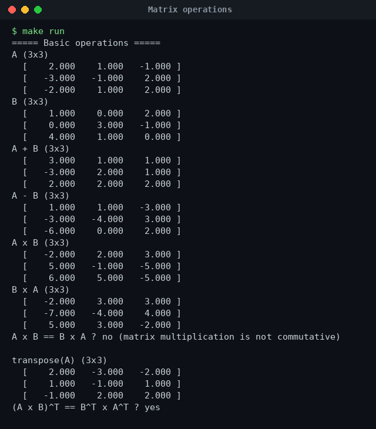
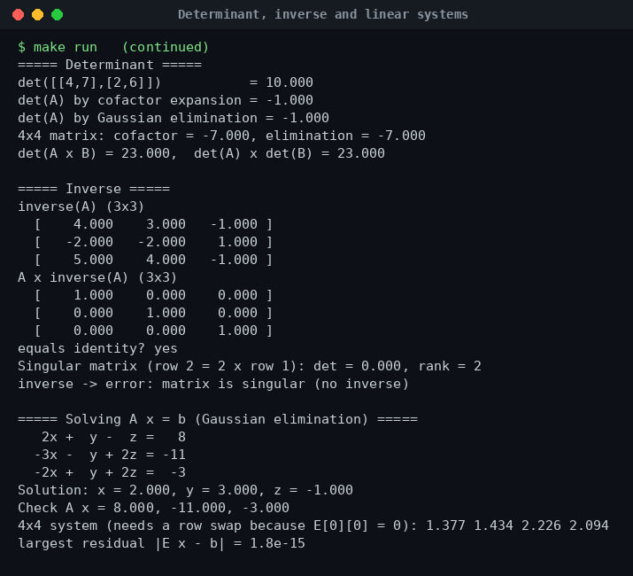

# Linear Algebra Projects (C++)


A `Matrix` class written from scratch in C++ for my **Linear Algebra** course, with the main operations and a linear-system solver. Every result is checked by the program itself (for example `A × A⁻¹ = I`).

## Features

| Operation | Method | Complexity |
|---|---|---|
| Addition / subtraction / scalar multiply | element-wise | O(n²) |
| Matrix multiplication | row × column | O(n³) |
| Transpose | swap indices | O(n²) |
| Determinant | cofactor (Laplace) expansion **and** Gaussian elimination | O(n!) / O(n³) |
| Inverse | Gauss–Jordan elimination with partial pivoting | O(n³) |
| Rank | row echelon form | O(n³) |
| Solve `Ax = b` | Gaussian elimination + back substitution | O(n³) |

Errors are handled: wrong sizes throw `invalid_argument`, and a singular matrix throws a clear "no inverse" error.

## Structure

```
include/Matrix.h     # class declaration
src/Matrix.cpp       # implementation
src/main.cpp         # demo with self-checks
Makefile
```

## Build and run

```bash
make run
# or
g++ -std=c++17 -Iinclude src/main.cpp src/Matrix.cpp -o linear_algebra && ./linear_algebra
```

## Example: solving a 3 × 3 system

```
 2x +  y -  z =   8
-3x -  y + 2z = -11
-2x +  y + 2z =  -3
```

Result: **x = 2, y = 3, z = −1** (verified by multiplying back).

## Properties checked by the program

- `A × B ≠ B × A` (multiplication is not commutative)
- `(A × B)ᵀ = Bᵀ × Aᵀ`
- `det(A × B) = det(A) × det(B)`
- both determinant methods give the same value (3 × 3 and 4 × 4)
- `A × A⁻¹ = I`
- a matrix with a dependent row has det = 0, rank 2 and no inverse

## Output





## Author

**Dheya Alhag** — BS Software Engineering, Superior University, Lahore
GitHub: [@dhiaalhaq7979](https://github.com/dhiaalhaq7979)
